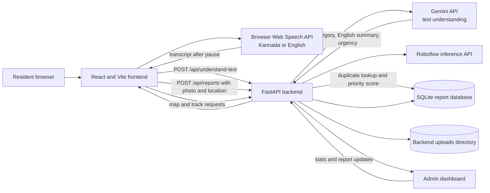

# CivicSathi AI

CivicSathi AI is a civic issue reporting prototype for neighbourhoods. Residents can report potholes and garbage issues with a photo, a map location, and an optional description. Reports can be viewed on a map, tracked by ID, and managed from an admin dashboard.

## Problem statement

Local infrastructure issues are often reported through disconnected channels, with limited location context and little visibility into what happens next. Duplicate reports can also make it harder for response teams to understand where attention is needed. CivicSathi AI gives residents one place to submit a photo and location, helps teams prioritize and organize reports, and lets residents check a report's status.

## How the pipeline works

1. A resident selects or takes an issue photo, pins a location, and optionally adds a written description or speaks one.
2. The backend sends the photo to the configured Roboflow inference models. If image detection is unavailable, the resident can choose the category manually.
3. When speech recognition is supported, the browser transcribes speech in Kannada (`kn-IN`) or English (`en-IN`). After speech pauses, the transcript can be sent to the backend's Gemini text-understanding endpoint. The response suggests a category, provides an English summary, and gives an urgency hint. This suggestion is shown to the resident and is not saved as part of the report.
4. The report API checks for nearby duplicates, calculates a priority score, saves the report in SQLite, and stores the uploaded image on the backend.
5. Residents can follow progress by report ID or explore located reports on the map. Admins can update status, assignments, deadlines, and resolution photos; dashboard counts and charts are based on report data from the API.

## Architecture



## Setup and run

### Prerequisites

- Python 3.10 or newer
- Node.js and npm
- Optional: Roboflow API credentials and model IDs for image detection
- Optional: a Gemini API key for text understanding

### Configure environment

From the project root, copy `.env.example` to `backend/.env` and fill in the credentials you plan to use. Keep this file local; `.env` files are ignored by `.gitignore`. The backend also reads the root `.env` as a fallback for existing setups.

```powershell
Copy-Item .env.example backend/.env
```

Configuration keys:

| Variable | Purpose |
| --- | --- |
| `ROBOFLOW_API_KEY` | Roboflow inference key; optional. |
| `ROBOFLOW_API_URL` | Roboflow inference API base URL. |
| `ROBOFLOW_MODEL_ID` | Pothole model ID; defaults to `pothole-detection-bqu6s-dwjbo/1`. |
| `ROBOFLOW_GARBAGE_MODEL_ID` | Garbage model ID; defaults to `garbage_detection-wvzwv/9`. |
| `ROBOFLOW_CONFIDENCE_THRESHOLD` | Minimum prediction confidence; defaults to `0.30`. |
| `ROBOFLOW_POTHOLE_PREFERENCE_THRESHOLD` | Prefer a strong pothole result when independent model confidences disagree; defaults to `0.85`. Validate this setting on negative photos before relying on it. |
| `GEMINI_API_KEY` | Gemini API key for description understanding; optional. |
| `ADMIN_PASSWORD` | Password required for admin API access. |
| `DATABASE_URL` | SQLAlchemy database URL; defaults to `sqlite:///./civic.db`. |

The report flow can still use manual category selection when image detection is not configured. Text understanding is optional when Gemini is not configured or the request fails. Startup logs warn when either key is missing; keys are never logged.

### Backend

In a terminal at the project root, create and activate a virtual environment, install requirements, and start FastAPI:

```powershell
cd backend
py -m venv venv
.\venv\Scripts\Activate.ps1
python -m pip install -r requirements.txt
python seed.py
uvicorn main:app --reload --host 0.0.0.0
```

The API listens on `http://localhost:8000`. Interactive API documentation is at `http://localhost:8000/docs`; the health check is at `http://localhost:8000/health`.

For pothole and garbage smoke tests, add real campus photos to `backend/data/potholes/` and `backend/data/garbage/`, then run `python test_detect.py .\data\potholes --csv .\data\pothole_smoke_results.csv` and `python test_detect.py .\data\garbage --csv .\data\garbage_smoke_results.csv` from the backend folder. The existing photo is a gravel-filled road repair, and two public pothole models returned zero predictions for it. For the requested accuracy result, add 10 pothole and 10 normal-road photos directly under `backend/data/`, fill `data/accuracy_labels.csv` from the example template, and run `python evaluate_detector.py` to produce the photo table and summary.

The six entries in `backend/config/zones.json` are demo sensitive zones around central Bengaluru, using the reference point you supplied. Replace them with points near your actual campus before relying on location-based priority scores.

### Frontend

Open a second terminal from the project root:

```powershell
cd frontend
npm install
npm run dev
```

Vite serves the app at `http://localhost:5173`. The frontend uses `http://localhost:8000` by default. To test on a phone on the same Wi-Fi, find the laptop's private IPv4 address, create `frontend/.env.local` with `VITE_API_URL=http://<laptop-ip>:8000`, restart Vite, and open `http://<laptop-ip>:5173` on the phone. The backend permits localhost and private-network Vite origins. The operating-system firewall must allow these local development ports.

The development backend allows the default Vite origin `http://localhost:5173` through CORS.

## Datasets, models, APIs and libraries used

| Name | Use | Author / source | URL | Licence |
| --- | --- | --- | --- | --- |
| Pothole detection model | Roboflow hosted object detection; model ID `pothole-detection-bqu6s-dwjbo/1` (2,475 images; published mAP@50 91.4%). | Project | [Roboflow Universe project](https://universe.roboflow.com/project-yjhi5/pothole-detection-bqu6s-dwjbo) | MIT |
| Garbage detection model | Roboflow hosted object detection; model ID `garbage_detection-wvzwv/9` (1,721 images). | Garbage detection | [Roboflow Universe project](https://universe.roboflow.com/garbage-detection-czeg5/garbage_detection-wvzwv) | CC BY 4.0 |
| Gemini 3.8 Flash | Text classification, English summary, and urgency hint. | Google | [Gemini model documentation](https://ai.google.dev/gemini-api/docs/models/gemini-3.8-flash) | Google API terms |
| Web Speech API | Optional in-browser speech recognition; availability depends on browser and platform. | Browser implementation | [MDN Web Speech API](https://developer.mozilla.org/en-US/docs/Web/API/Web_Speech_API) | Browser/platform terms |
| Map tiles | Location picker and report map tiles. | OpenStreetMap contributors | [OpenStreetMap copyright](https://www.openstreetmap.org/copyright) | Follow the provider's tile usage policy |
| FastAPI, SQLAlchemy, SQLite, Requests, Pillow | Backend API, persistence, HTTP requests, and image handling. | Open-source maintainers | [FastAPI](https://fastapi.tiangolo.com/) · [SQLAlchemy](https://www.sqlalchemy.org/) | See each project |
| React, Vite, Tailwind CSS, Leaflet, Recharts, Framer Motion, Lucide | Frontend interface, styling, maps, charts, animation, and icons. | Open-source maintainers | [React](https://react.dev/) · [Vite](https://vite.dev/) · [Tailwind CSS](https://tailwindcss.com/) · [Leaflet](https://leafletjs.com/) · [Recharts](https://recharts.org/) | See each project |

The reported Roboflow metrics and dataset sizes are from the linked project pages and are not an independent evaluation on this project's photos. Keep attribution with any redistributed model or dataset.

## AI usage disclosure

- GitHub Copilot was used for code generation.
- Roboflow hosted inference is used for pothole and garbage object detection; the model sources and licences are listed above.
- The Gemini API (`gemini-3.8-flash`) is used by `POST /api/understand-text` to interpret a user-provided description and return a category, an English summary, and an urgency hint.
- The description-understanding result is an optional aid for the user; it does not replace photo detection or automatically change the submitted report category.

## Limitations

- The image workflow is configured for pothole and garbage categories. Detection quality depends on the Roboflow models and credentials supplied by the deployer.
- Without available image detection, the reporter must choose a category manually.
- Gemini text understanding requires network access and a valid `GEMINI_API_KEY`. Its category and urgency are suggestions, not verified facts, and the result is not persisted with the report.
- Speech recognition depends on browser support, language availability, microphone permission, and a secure browser context. The microphone control is hidden when the browser exposes no Web Speech recognition implementation.
- Location selection, map tiles, Roboflow inference, and Gemini text understanding require network connectivity.
- The admin password is a simple shared-secret gate intended for this prototype, not a substitute for a production identity and access management system.
- The included sample photo is only a smoke-test example. It does not establish model accuracy; measure accuracy on a separate, labeled set of positive and negative images.

## Related work

CivicSathi AI follows the civic-tech pattern of combining resident-submitted issue reports, geographic context, and visible status updates. This project adds photo-based categorization, duplicate awareness, priority scoring, and optional speech-assisted descriptions to that workflow.

## Team

- **Team name:** [Add team name]
- **Members:** [Add member names and roles]
